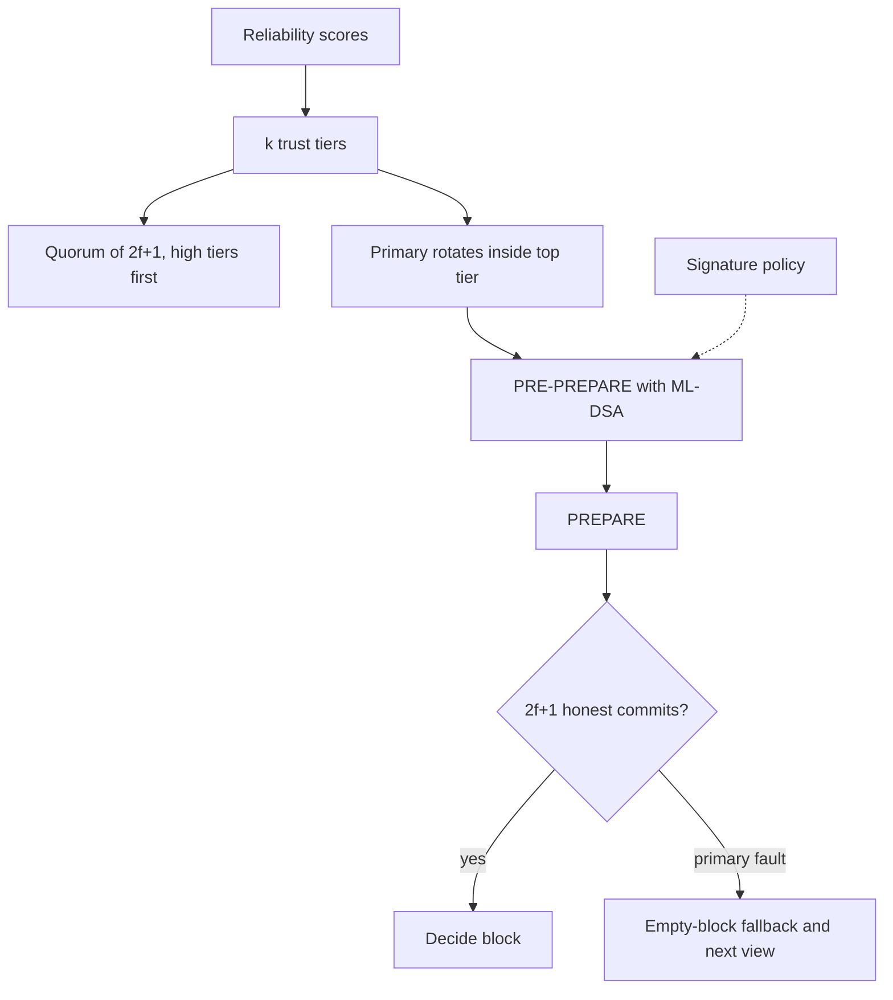

# Protocol sketch

Normal case is the classical three phases. View change is replaced by the empty-block vote described in the concept paper, which keeps the simulated message count at \(O(q^2)\) for quorum size \(q\).
